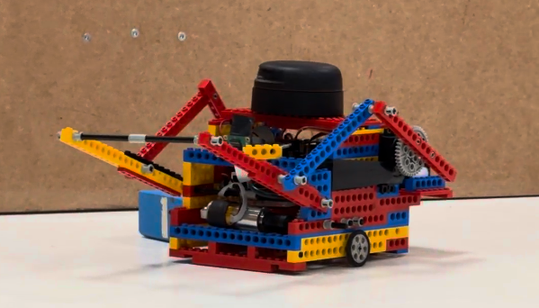

# Robotics Course – Final Project

A robotics project developed in C++, featuring LiDAR scanning, odometry, sensor integration, and localization using Kalman filtering and scan matching.

## Robot

## Demo

[▶ Watch on YouTube](https://www.youtube.com/shorts/FkgGKHNwfeM)